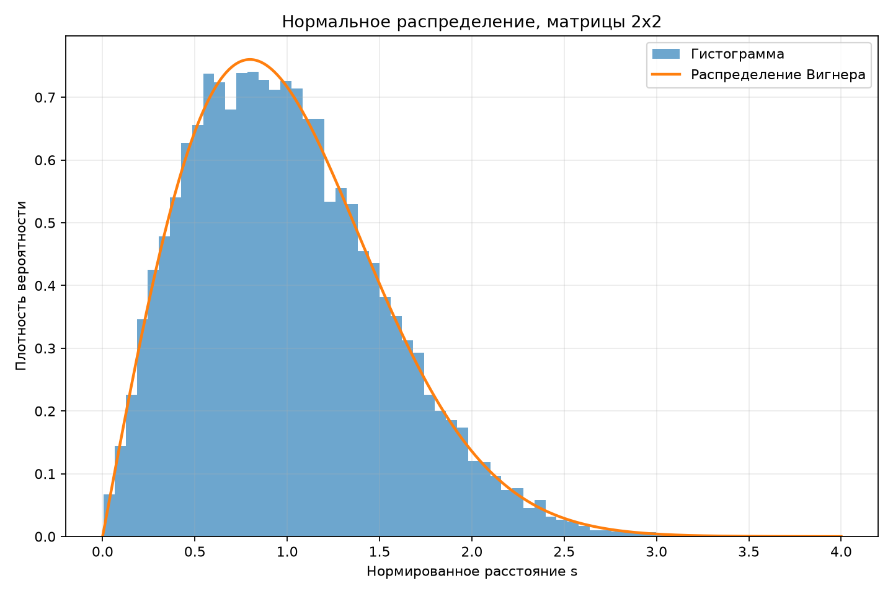
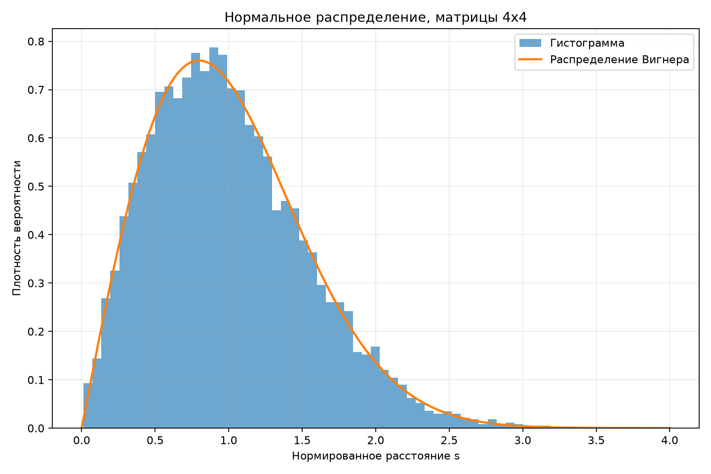
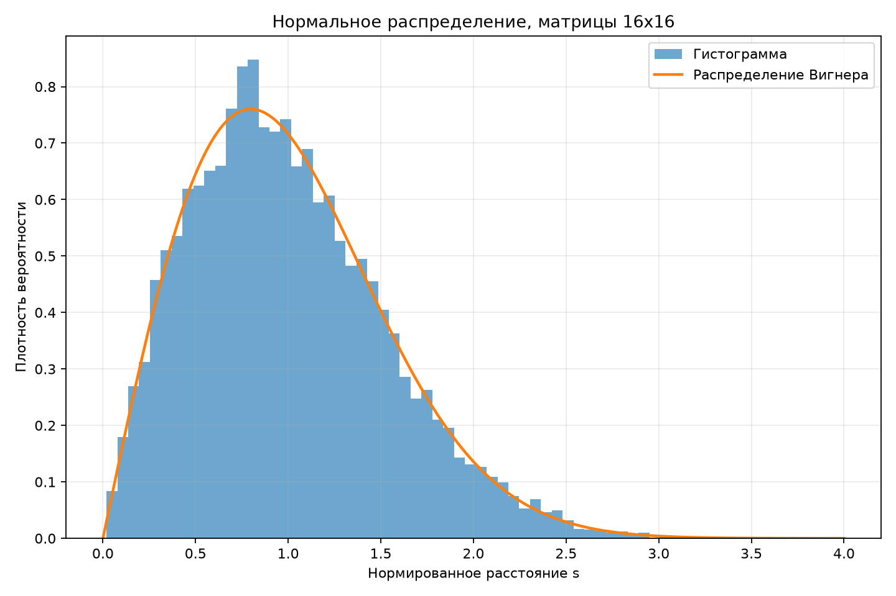
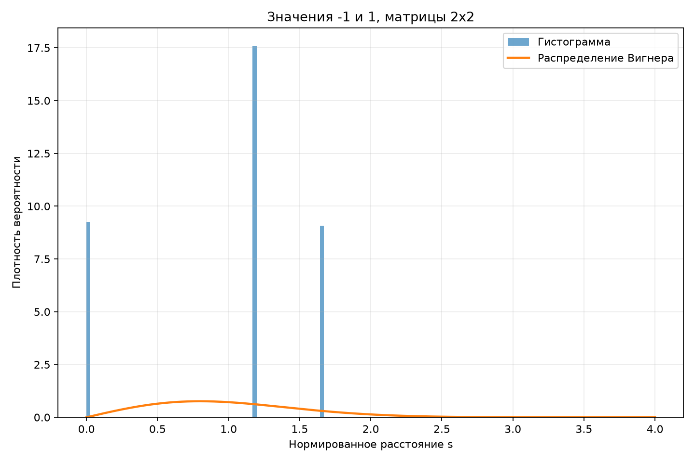
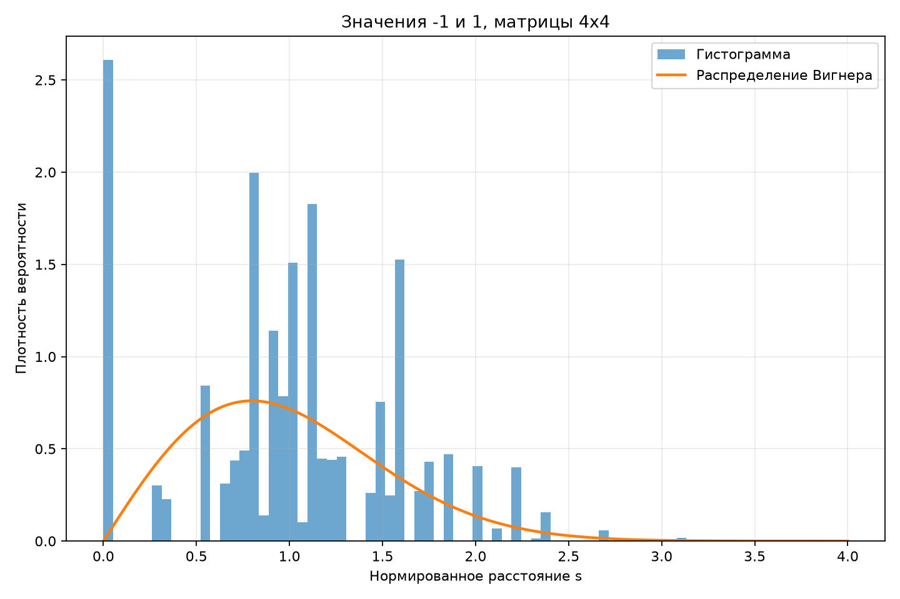

# Лабораторная работа №2
## «Свойства случайных матриц»

### Цель работы

Исследовать распределение расстояний между соседними собственными значениями случайных симметричных матриц и сравнить полученные результаты с распределением Вигнера.

### Ход работы

Для каждого размера матриц `2×2`, `4×4` и `16×16` был сгенерирован ансамбль из 10000 случайных матриц.

Сначала элементы исходной матрицы генерировались независимо, после чего матрица симметризовалась:

$$
B = A + A^T
$$

Для каждой полученной симметричной матрицы вычислялись собственные значения и сортировались по возрастанию.

В каждой матрице использовалась одна и та же фиксированная пара соседних собственных значений — центральная пара:

$$
s = \lambda_{k+1} - \lambda_k
$$

Полученные расстояния нормировались делением на их среднее значение:

$$
s_{norm} = \frac{s}{\langle s \rangle}
$$

После такой нормировки среднее расстояние равно 1.

Для сравнения использовалось распределение Вигнера:

$$
\rho(s)=\frac{\pi s}{2}e^{-\frac{\pi s^2}{4}}
$$

---

## 1. Матрицы с нормально распределёнными элементами

Элементы исходных матриц имели нормальное распределение со средним значением 0 и среднеквадратичным отклонением 1.

### Матрицы 2×2

Среднее расстояние до нормировки:

$$
\langle s \rangle \approx 3.5629
$$

После нормировки:

$$
\langle s_{norm} \rangle = 1
$$



### Матрицы 4×4

Среднее расстояние до нормировки:

$$
\langle s \rangle \approx 2.3667
$$

После нормировки:

$$
\langle s_{norm} \rangle = 1
$$



### Матрицы 16×16

Среднее расстояние до нормировки:

$$
\langle s \rangle \approx 1.1368
$$

После нормировки:

$$
\langle s_{norm} \rangle = 1
$$



Во всех трёх случаях около нуля плотность вероятности мала. Это связано с отталкиванием уровней: вероятность получить два очень близких соседних собственных значения у случайной симметричной матрицы мала.

Полученные гистограммы достаточно хорошо совпадают с теоретической кривой распределения Вигнера.

---

## 2. Матрицы с элементами -1 и 1

Далее опыт был повторён для матриц, элементы которых принимают значения `-1` и `1` с одинаковой вероятностью:

$$
P(-1)=P(1)=\frac12
$$

### Матрицы 2×2

Среднее расстояние до нормировки:

$$
\langle s \rangle \approx 3.3867
$$



### Матрицы 4×4

Среднее расстояние до нормировки:

$$
\langle s \rangle \approx 2.5534
$$



### Матрицы 16×16

Среднее расстояние до нормировки:

$$
\langle s \rangle \approx 1.1696
$$


Для матриц малого размера распределение заметно отличается от распределения Вигнера. Это связано с тем, что элементы принимают только два возможных значения, поэтому число возможных комбинаций матриц и расстояний между собственными числами ограничено.

Для матриц `16×16` гистограмма уже становится очень похожей на результат для нормально распределённых элементов и на теоретическую кривую Вигнера.

---

## 3. Аналитический результат для матриц 2×2 с элементами -1 и 1

Пусть исходная матрица имеет вид:

$$
A =
\begin{pmatrix}
a & b \\
c & d
\end{pmatrix}
$$

где

$$
a,b,c,d \in \{-1,1\}
$$

и каждое значение выбирается с вероятностью `1/2`.

После симметризации:

$$
B=A+A^T=
\begin{pmatrix}
2a & b+c \\
b+c & 2d
\end{pmatrix}
$$

Для симметричной матрицы

$$
\begin{pmatrix}
x & y \\
y & z
\end{pmatrix}
$$

расстояние между двумя собственными значениями равно:

$$
s=\sqrt{(x-z)^2+4y^2}
$$

Поэтому в нашем случае:

$$
s=\sqrt{(2a-2d)^2+4(b+c)^2}
$$

Величина `a-d` равна нулю с вероятностью `1/2`, а значения `2` или `-2` имеют суммарную вероятность `1/2`.

Аналогично, `b+c` равно нулю с вероятностью `1/2`, а значения `2` или `-2` имеют суммарную вероятность `1/2`.

Получаются три возможных значения расстояния:

| Расстояние | Вероятность |
|---|---:|
| $0$ | $1/4$ |
| $4$ | $1/2$ |
| $4\sqrt2$ | $1/4$ |

Среднее расстояние:

$$
\langle s\rangle=
0\cdot\frac14+
4\cdot\frac12+
4\sqrt2\cdot\frac14
$$

$$
\langle s\rangle=2+\sqrt2\approx3.4142
$$

После нормировки возможные значения равны:

$$
0
$$

$$
\frac{4}{2+\sqrt2}\approx1.1716
$$

$$
\frac{4\sqrt2}{2+\sqrt2}\approx1.6569
$$

с вероятностями `1/4`, `1/2` и `1/4` соответственно.

Таким образом, для матриц `2×2` распределение имеет дискретный характер и не может совпадать с гладкой кривой распределения Вигнера.

Кроме того, существует ненулевая вероятность получить:

$$
s=0
$$

Поэтому для данного дискретного ансамбля матриц размера `2×2` отталкивание уровней в точности не выполняется.

---

## 4. Численные результаты

Для оценки близости гистограмм к распределению Вигнера была вычислена средняя абсолютная разница между значениями плотности гистограммы и теоретической функции.

| Распределение элементов | Размер | Среднее расстояние до нормировки | Среднее после нормировки | Средняя ошибка |
|---|---:|---:|---:|---:|
| Нормальное | 2×2 | 3.5629 | 1.0000 | 0.0125 |
| Нормальное | 4×4 | 2.3667 | 1.0000 | 0.0119 |
| Нормальное | 16×16 | 1.1368 | 1.0000 | 0.0146 |
| -1 и 1 | 2×2 | 3.3867 | 1.0000 | 0.4762 |
| -1 и 1 | 4×4 | 2.5534 | 1.0000 | 0.2437 |
| -1 и 1 | 16×16 | 1.1696 | 1.0000 | 0.0142 |

Из таблицы видно, что для нормально распределённых элементов результаты всех трёх размеров хорошо согласуются с распределением Вигнера.

Для элементов `-1` и `1` отличие очень большое для размера `2×2`, уменьшается для `4×4` и практически исчезает для `16×16`.

---

## Вывод

В ходе лабораторной работы были исследованы расстояния между соседними собственными значениями случайных симметричных матриц.

Для матриц с нормально распределёнными элементами полученные гистограммы хорошо совпадают с распределением Вигнера. В окрестности нуля вероятность малых расстояний стремится к нулю, что соответствует эффекту отталкивания уровней.

Для матриц с элементами `-1` и `1` при размере `2×2` распределение имеет дискретный характер и значительно отличается от распределения Вигнера. Аналитически было получено, что расстояние между собственными числами может принимать только значения `0`, `4` и `4√2`.

При увеличении размера матрицы влияние дискретности элементов становится менее заметным. Для матриц `16×16` гистограмма уже оказывается близкой к распределению Вигнера и к результатам для матриц с нормально распределёнными элементами.

## Публичный интерфейс

В файле `lab2_solution.py` задан публичный интерфейс модуля через переменную `__all__`.

Доступны следующие функции:

- `wigner_distribution` — вычисляет значение распределения Вигнера;
- `generate_matrix` — генерирует случайную симметричную матрицу;
- `eigenvalue_spacing` — вычисляет расстояние между фиксированной центральной парой соседних собственных значений;
- `generate_spacings` — получает набор расстояний для ансамбля матриц;
- `normalize_spacings` — нормирует расстояния так, чтобы их среднее значение было равно единице;
- `histogram_error` — оценивает отличие гистограммы от распределения Вигнера;
- `bernoulli_2x2_analytic` — возвращает аналитический результат для матриц `2×2` с элементами `-1` и `1`.

Пример использования:

```python
import numpy as np
from lab2_solution import generate_spacings, normalize_spacings

rng = np.random.default_rng(42)
spacings = generate_spacings(4, 'normal', 1000, rng)
normalized, mean_spacing = normalize_spacings(spacings)

print(mean_spacing)
print(normalized.mean())
```

## Юнит-тесты

Для проверки основных частей программы добавлен файл `test_lab2.py` с четырьмя тестами.

Проверяется:

1. Симметричность сгенерированной матрицы.
2. Правильность вычисления расстояния между собственными значениями на простой диагональной матрице.
3. Нормировка набора расстояний до среднего значения 1.
4. Аналитический результат для матриц `2×2` с элементами `-1` и `1`.

Запуск тестов:

```bash
python -m unittest -v test_lab2.py
```

Результат запуска:

```text
Ran 4 tests

OK
```
